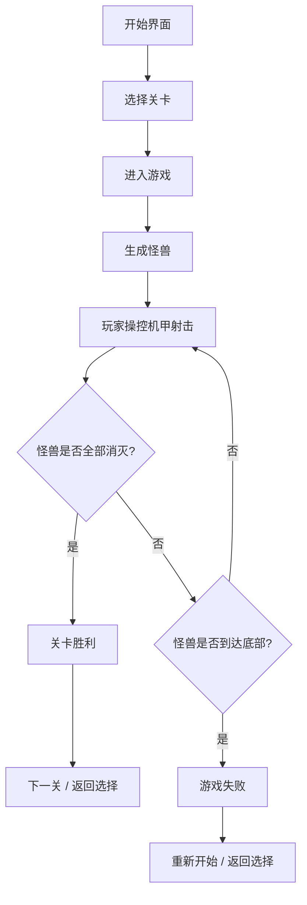

## 1. 产品概述

机甲大战怪兽是一款基于Canvas的2D射击游戏，玩家操控机甲使用炮弹消灭入侵的怪兽，穿越8个风格各异的星球场景，挑战逐渐升级的难度。

- **核心玩法**：玩家控制机甲左右移动并发射炮弹，消灭从屏幕上方出现的怪兽
- **目标用户**：休闲游戏玩家，喜欢射击类游戏的用户
- **市场价值**：轻量化网页游戏，无需安装，打开即玩，适合碎片化时间娱乐

## 2. 核心功能

### 2.1 游戏角色

| 角色 | 描述 | 属性 |
|------|------|------|
| 机甲 | 玩家操控的战斗单位 | 可左右移动，发射炮弹 |
| 小型怪兽 | 基础敌人单位 | 3炮消灭，移动速度较快 |
| 大型怪兽 | 精英敌人单位 | 20炮消灭，移动速度较慢，血量高 |

### 2.2 功能模块

1. **开始界面**：游戏标题、开始按钮、关卡选择
2. **游戏主界面**：Canvas游戏画布、HUD信息（关卡、分数、生命值）
3. **关卡系统**：8个关卡，每关10只怪兽，难度递增
4. **战斗系统**：机甲移动、炮弹发射、碰撞检测、伤害计算
5. **结算界面**：胜利/失败展示、分数统计、重新开始选项

### 2.3 关卡详情

| 关卡 | 场景 | 大型怪兽数量 | 小型怪兽数量 | 总怪兽数 |
|------|------|-------------|-------------|---------|
| 第1关 | 太空 | 0 | 10 | 10 |
| 第2关 | 海洋 | 1 | 9 | 10 |
| 第3关 | 撒哈拉大沙漠 | 2 | 8 | 10 |
| 第4关 | 火星 | 3 | 7 | 10 |
| 第5关 | 月球 | 4 | 6 | 10 |
| 第6关 | 非洲大草原 | 5 | 5 | 10 |
| 第7关 | 热带雨林 | 6 | 4 | 10 |
| 第8关 | 海王星 | 7 | 3 | 10 |

## 3. 核心流程

## 4. 用户界面设计

### 4.1 设计风格

- **整体风格**：科幻机甲风，充满未来感和战斗气息
- **主色调**：深蓝色（#0a1628）作为背景主色，青蓝色（#00d4ff）作为科技感强调色
- **辅助色**：红色（#ff4757）表示危险/伤害，绿色（#2ed573）表示生命/成功
- **字体**：使用Orbitron（科技感字体）作为标题字体，系统无衬线字体作为正文
- **视觉效果**：霓虹发光效果、粒子特效、屏幕震动反馈

### 4.2 页面设计概览

| 页面 | 模块 | UI元素 |
|------|------|--------|
| 开始界面 | 标题区 | 游戏大标题、副标题、霓虹发光效果 |
| 开始界面 | 按钮区 | 开始游戏按钮、关卡选择按钮、悬停动画 |
| 关卡选择 | 关卡网格 | 8个关卡卡片、场景预览、锁定/解锁状态 |
| 游戏界面 | HUD | 关卡编号、分数、生命值、暂停按钮 |
| 游戏界面 | Canvas | 游戏主画布、机甲、怪兽、炮弹、特效 |
| 结算界面 | 结果展示 | 胜利/失败标题、分数统计、星级评价 |
| 结算界面 | 操作按钮 | 重新开始、下一关、返回主菜单 |

### 4.3 响应式

- 采用固定画布尺寸（800x600），居中显示
- 适配不同屏幕尺寸，背景自适应填充
- 支持键盘操作（方向键/AD移动，空格射击）
