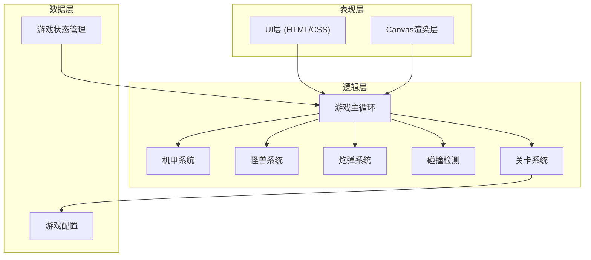

## 1. 架构设计



## 2. 技术描述

- **前端技术**：HTML5 Canvas + TypeScript + Vite
- **构建工具**：Vite 5.x
- **语言**：TypeScript 5.x
- **样式**：原生CSS（CSS Variables + CSS Animations）
- **状态管理**：原生TypeScript类 + 单例模式
- **无后端**：纯前端游戏，数据保存在localStorage

## 3. 目录结构

```
src/
├── game/
│   ├── Game.ts          # 游戏主类，管理游戏循环
│   ├── Player.ts        # 机甲类
│   ├── Enemy.ts         # 怪兽基类及子类
│   ├── Bullet.ts        # 炮弹类
│   ├── Level.ts         # 关卡管理
│   ├── Scene.ts         # 场景渲染
│   ├── Particle.ts      # 粒子特效
│   └── types.ts         # 类型定义
├── ui/
│   ├── StartScreen.ts   # 开始界面
│   ├── LevelSelect.ts   # 关卡选择
│   ├── HUD.ts           # 游戏HUD
│   └── GameOver.ts      # 结算界面
├── config/
│   └── gameConfig.ts    # 游戏配置常量
├── utils/
│   ├── input.ts         # 输入处理
│   └── collision.ts     # 碰撞检测工具
├── main.ts              # 入口文件
└── style.css            # 全局样式
```

## 4. 核心类定义

### 4.1 Game 类
```typescript
class Game {
  canvas: HTMLCanvasElement;
  ctx: CanvasRenderingContext2D;
  player: Player;
  enemies: Enemy[];
  bullets: Bullet[];
  particles: Particle[];
  currentLevel: number;
  score: number;
  lives: number;
  state: GameState;
  
  start(): void;
  pause(): void;
  resume(): void;
  restart(): void;
  nextLevel(): void;
  gameOver(victory: boolean): void;
}
```

### 4.2 Enemy 类体系
```typescript
abstract class Enemy {
  x: number;
  y: number;
  width: number;
  height: number;
  hp: number;
  maxHp: number;
  speed: number;
  score: number;
  
  update(deltaTime: number): void;
  draw(ctx: CanvasRenderingContext2D): void;
  takeDamage(damage: number): boolean;
}

class SmallEnemy extends Enemy {
  // 小型怪兽：3HP，速度快
}

class LargeEnemy extends Enemy {
  // 大型怪兽：20HP，速度慢，体积大
}
```

### 4.3 关卡配置
```typescript
interface LevelConfig {
  id: number;
  name: string;
  scene: SceneType;
  largeEnemyCount: number;
  smallEnemyCount: number;
  backgroundGradient: string[];
}

type SceneType = 'space' | 'ocean' | 'desert' | 'mars' | 'moon' | 'savanna' | 'rainforest' | 'neptune';
```

## 5. 游戏循环机制

1. **输入处理阶段**：读取键盘输入，更新机甲位置
2. **更新阶段**：更新所有游戏对象（机甲、怪兽、炮弹、粒子）
3. **碰撞检测阶段**：检测炮弹与怪兽、怪兽与底部边界的碰撞
4. **渲染阶段**：绘制背景、所有游戏对象、UI元素
5. **状态判断**：判断关卡是否完成或游戏是否失败

## 6. 性能优化

- 使用对象池管理炮弹和粒子，减少GC开销
- 离屏canvas预渲染静态背景
- 限制最大同屏怪兽数量
- 使用requestAnimationFrame保证60fps
